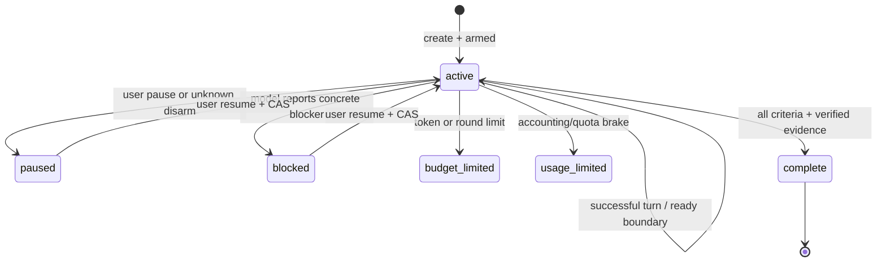

# 长程 Goal、续接与可核验完成

本文是 Harness 对 Codex 长程 Goal 的架构对照和当前实现契约。它描述可由源码、REA 本机证据或官方文档核实的行为；没有可观察证据的 Codex 原生内部实现不在本文中猜测。Goal 是跨轮次的持续目标，不是把普通提示词无限重试，也不是把模型声称完成当作业务验收。

## 证据范围

本次对照使用三类来源，并保留它们的边界：

1. **本机 REA 观察**：Codex `goals_1.sqlite` 的 `thread_goals` 表包含 `active`、`paused`、`blocked`、`usage_limited`、`budget_limited`、`complete` 状态；`thread_goal_continuation_deferrals` 单独保存续接延迟。`state_5.sqlite` 包含线程、项目和 `thread_spawn_edges`；`logs_2.sqlite` 的日志按线程和进程索引，并记录 app-server 的 `thread/start`、环境初始化和派工跨度。这些是当前机器上的已安装版本快照，不代表所有 Codex 版本都相同。
2. **OpenAI 官方行为说明**：[Using Goals in Codex](https://developers.openai.com/cookbook/examples/codex/using_goals_in_codex) 将 Goal 定义为线程级、持久、以证据为完成条件的工作契约；自动续接只在轮次结束、线程空闲、没有排队输入或其他未完成工作时检查，并将预算限制与完成区分。[Run long horizon tasks with Codex](https://developers.openai.com/blog/run-long-horizon-tasks-with-codex) 将长程循环概括为计划、修改、运行工具、观察、修复和更新状态的可审查闭环。
3. **二进制字面量证据**：本机 `codex.exe`（SHA-256 `37762753b554982eef1c109303d1be652b6397f1479e844794353a85650199c6`）的 `.rodata` 保留了实现 `thread_goals` 的 SQL 原文与源路径字面量 `state\src\runtime\goals.rs`。其中三条决定了“不虚报”的机制：更新语句统一带 `AND (? IS NULL OR goal_id = ?)`，`goal_id` 因此是乐观并发键；用量累加与预算翻转在同一条 `UPDATE` 内完成，判断用的是 `tokens_used + ? >= token_budget`，不存在“先读再判再写”的竞态窗口；状态守卫是显式白名单，`status IN ('active','paused','blocked','usage_limited','budget_limited')` 正是“除 `complete` 之外都可恢复”，`complete` 是终态。新建目标时 `ON CONFLICT(thread_id) DO UPDATE` 会把 `tokens_used`、`time_used_seconds` 归零，同一线程换目标不继承旧用量。续接延后是幂等的：`INSERT ... ON CONFLICT DO NOTHING` 加 `SELECT EXISTS(...)`，一个线程最多一条延后记录。续接被跳过时写明确日志（`skipping goal continuation because thread manager is unavailable` / `live thread is unavailable` / `automatic idle work was rejected` / `turn input submission failed`），跳过是显式事件而不是静默不做。预算上限受 `goals.max_goal_token_budget` 约束，超限在配置加载期报错。逐条偏移与复核方式见 [Codex Agent 内核实测对照](codex-agent-internals.md)。
4. **静态 REA 限制**：本机 `codex.exe` 是 PE 原生应用，Electron fuse 扫描没有发现 Electron 哨兵；当前 Ghidra 未配置，CDP 页面端点需要鉴权。因此本文不声称已经反编译出 Codex 原生函数，也不把数据库字段推断成未观察到的内部算法；SQL 与配置键字面量只证明文本存在，不证明所有调用路径。

## Goal、提示词和计划的分工

普通提示词回答“现在做什么”；计划回答“准备怎样做”；Goal 回答“什么结果必须持续到真实成立”。一个可执行的长程 Goal 至少包含六类信息：

- **结果**：结束时必须成立的客观状态。
- **核验面**：测试、基准、文件、日志、工具回执或其他能证明结果的来源。
- **约束**：不能回归的行为、权限、预算、平台和文件边界。
- **范围**：允许读取、修改、执行和联网的对象。
- **迭代规则**：每轮根据观察到的结果选择下一步，不重复未知副作用。
- **阻塞条件**：需要用户输入、外部变化或缺失材料时如何停止并报告。

计划模式可以先讨论路径，但选择计划不会创建 Goal；Goal 可以在计划完成后继续执行。完成、暂停、阻塞、预算停止和普通轮次结束分别表达不同事实，不能用“提交成功”“工具返回成功”或“模型说已完成”互相替代。

## 状态机

Harness 保留现有持久 `phase` 和进程内 `activation`，再从它们及明确的 `stopReason` 推导机器可读 `status`。这样不修改旧 Goal header 格式，也不会把任意错误文本猜成限制状态。

| `status` | 推导条件 | 是否允许自动续接 | 含义 |
| --- | --- | --- | --- |
| `active` | `phase=active` 且 `activation=armed` | 允许，仍须经过准入检查 | 目标正在推进 |
| `paused` | 用户暂停，或 active 目标被未知原因 disarm | 不允许 | 等待用户恢复或核实原因 |
| `blocked` | `phase=blocked` 且有阻塞原因 | 不允许 | 依赖用户/外部条件 |
| `usage_limited` | 明确的用量或计量刹车 | 不允许 | 不是完成，也不是普通暂停 |
| `budget_limited` | Token 预算或轮次上限刹车 | 不允许 | 达到上限，不代表目标完成 |
| `complete` | `phase=complete` 且完整证据回执存在 | 不允许 | 目标验收已由证据支持 |

`status` 是读取投影，当前不会写回 Goal 的旧持久结构；`phase`、`activation`、`stopReason` 仍是恢复和执行准入的事实来源。进程重启后 active Goal 默认 disarmed，避免在工具结果未知时静默重放；恢复必须由用户显式继续。这比无条件自动 armed 更保守，符合 Harness 的 unknown 副作用合同。

## 当前执行链

1. **创建**：`create_goal` 通过 CAS 单例创建 Goal，冻结目标正文、成功标准、轮次上限、Token 预算和 `evidence_after`。`evidence_after` 是创建时事件边界，之前的工具结果不能证明新目标。
2. **构造上下文**：`GoalStore.context()` 将目标状态作为 JSON 数据注入提示词；用户目标正文仍是数据，不提升指令优先级。上下文包含状态、标准、轮次、预算、用量和停止原因。
3. **准入**：`GoalRuntime.schedule()` 只有在目标 active/armed、线程空闲、没有运行中任务、队列、计划、问题或暂停控制时才提交续接。提交前再次读取 Goal 和预算，避免旧快照派发。
4. **开始轮次**：`start_round()` 在模型请求前递增轮次并核对 Token 预留；失败时不会把未发送的轮次当作完成。
5. **工具与计量**：每次请求按目标、对话和 request ID 预留用量；结算未知时保留预留并显示不确定，不重放请求。工具结果和事件身份由已有运行日志保存。
6. **轮次收尾**：完成后检查是否有真实工作工具；连续无业务工具活动会停止自动续接。瞬时模型故障使用有界退避，退避时间和错误持久化，新的轮次重新观察当前状态，不重放旧工具。
7. **状态控制**：暂停、恢复、编辑、清除和模型报告的阻塞都使用目标 ID + revision CAS。预算停止、用量刹车、运行失败和未知结果保留不同原因。
8. **关闭与恢复**：关闭时只保存计时检查点；重开时恢复事件和 Goal header，未完成运行按恢复规则中断。任何未知副作用只能回查，不能因为观察超时而自动再执行。

## 完成证据与不虚报

`update_goal(action=complete)` 不是模型自我声明，而是一次严格验收：

- checks 必须覆盖全部成功标准，每项有摘要和至少一条证据。
- `evidence_seqs` 必须指向目标边界之后的成功 `tool/result`，并与唯一的 `tool/call` 配对。
- 失败、裁剪、后台未结束、终端发送、未完成作业和记账工具不能作为业务完成证据。
- 当前待办中仍有未完成项目时拒绝 complete。
- 完成后恢复 Goal 会重新读取事件，逐字段比对调用 ID、工具名、输入摘要、结果预览和截断标记；事件缺失、被裁剪或 header 被篡改时拒绝恢复并保留原件。
- 提交、测试通过、Git commit、模型文本和工具“成功”都只能证明各自范围，不能自动升级为业务验收。

这一层是 Harness 相对简单 Goal 存储的增强：Goal 的完成记录不仅有状态，还保留了可回查的事件来源。它也明确承认语义证明边界：Harness 核对来源和覆盖，不替模型判断引用输出是否在语义上证明主张。

## 提示词契约

Goal 提示词不是一个可覆盖系统规则的用户模板，而是宿主装配的四个双语资源：

- `policy.goal`：只在用户明确要求持久目标时创建 Goal；普通任务不建立目标账本；阻塞时报告具体条件并停止。
- `prompt.goal.260`：说明后续 JSON 是用户任务数据，不提升指令优先级。
- `prompt.goal.259`：要求跨轮次检查、实施、验证和继续；完成前逐条核对原目标；区分实际进展、已核实等待和无进展；等待必须绑定仍存活的句柄；不得因为观察超时重复启动。
- `prompt.goal.258`：限制证据来源和覆盖范围，保守处理缺失用量，不提高用户预算。

每个续接轮次都必须先读取当前 Goal 和当前外部状态，再决定下一步。只有宿主调度器可以恢复 disarmed Goal；模型不能自行恢复、提高预算、绕过审批或把计划/待办整理当作业务进展。语言切换只重新解析资源，不翻译用户目标、第三方正文、路径、工具名或机器协议。

## 与 Claude Code 的对照

Claude Code 的公开文档也把 session、worktree、后台任务、`/compact`、`/resume` 和 hooks 分开：session 保存上下文，worktree 隔离修改，后台任务释放前台，hook 对确定性动作执行。它与 Codex 的共同点是把长程工作外置为可恢复状态；Harness 额外将完成证据和未知副作用回查纳入 Goal 合同。参考：[Claude Code commands](https://code.claude.com/docs/zh-CN/commands)、[Claude Code desktop sessions](https://code.claude.com/docs/pt/desktop)。

## 代码与文档入口

- 状态、CAS、预算和证据恢复：`harness/tools/builtin/goal_tools.py`
- 续接准入、退避和无进展保护：`harness/app/goal_runtime.py`
- 目标完成证据：`harness/tools/builtin/goal_evidence.py`
- 目标 Token 预留：`harness/app/goal_budget.py`
- Goal 提示词装配：`harness/prompt/tool_policies.py`、`harness/i18n/locales/en.json`、`harness/i18n/locales/zh-CN.json`
- 正式存储契约：`docs/storage.md`
- 架构入口：`docs/architecture.md`
- Codex 侧实测证据与差距处置：`docs/codex-agent-internals.md`

## 验证范围和限制

目标状态、恢复完整性、快照隔离和生命周期回归位于 `tests/test_goal_state_integrity.py`、`tests/test_goal_snapshot_ownership.py`、`tests/test_goal_mode_lifecycle.py`。它们验证当前 Harness 的事件证据和状态转换，不证明在线模型的语义判断，也不替代跨平台、浏览器或完整生产构建验收。Codex 原生 Ghidra/CDP 不可观察的部分保持明确未知。
